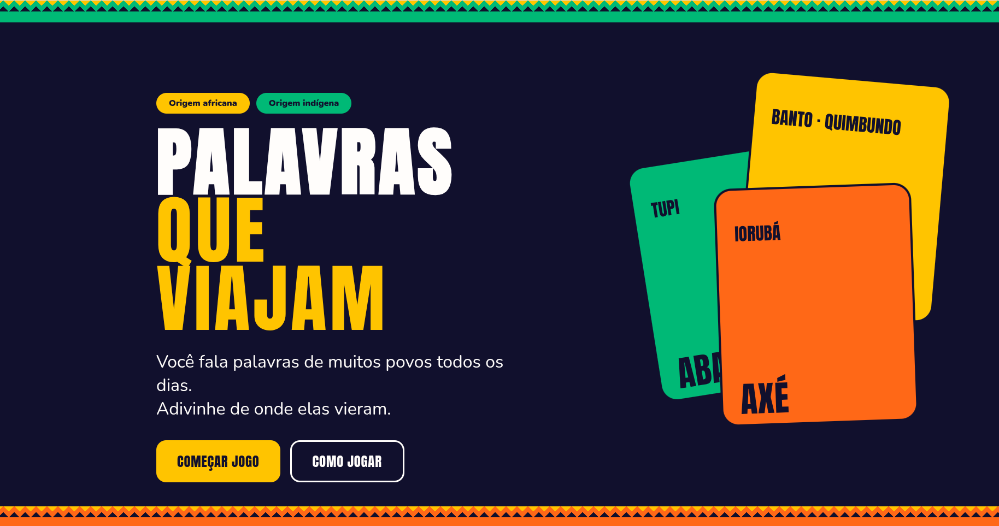
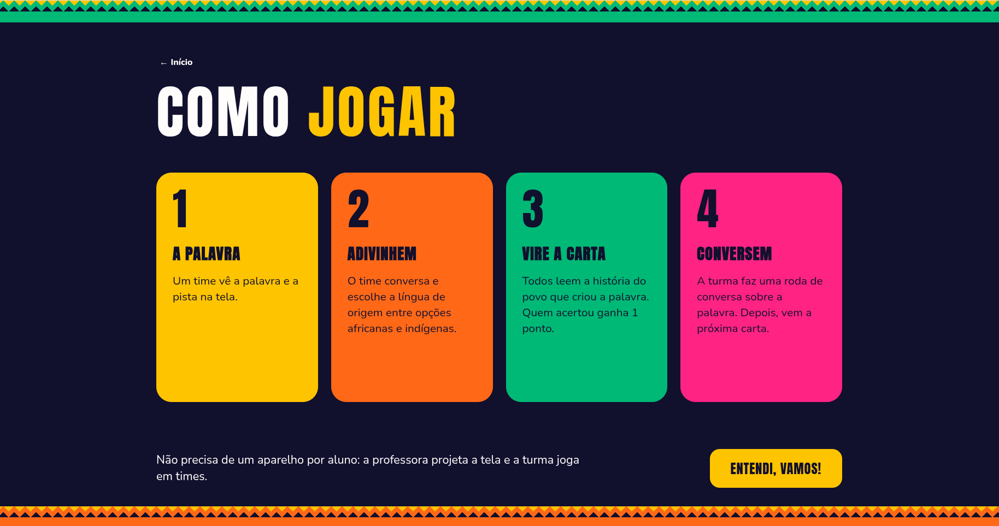
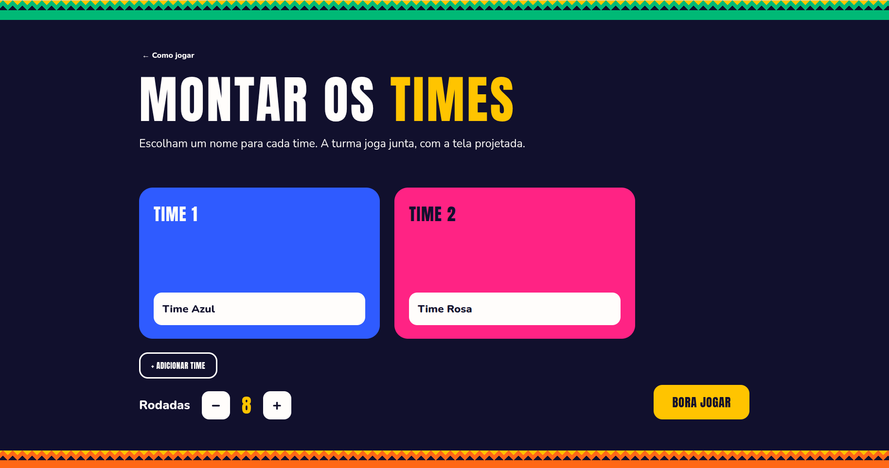
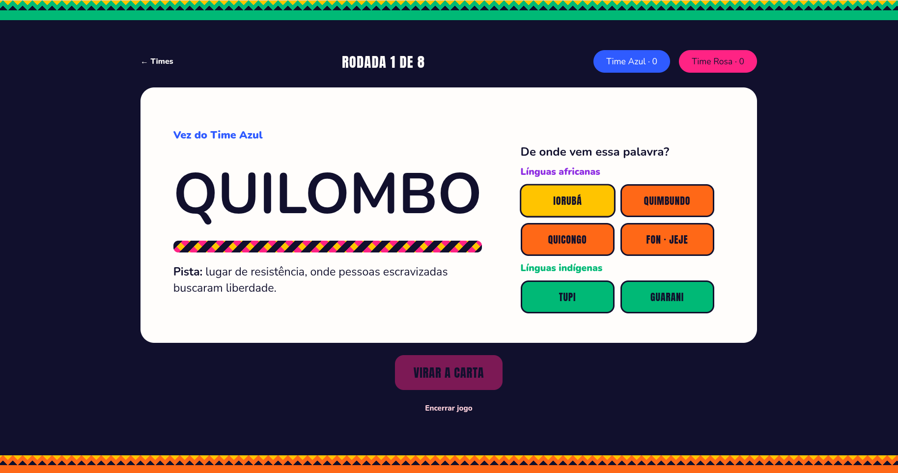
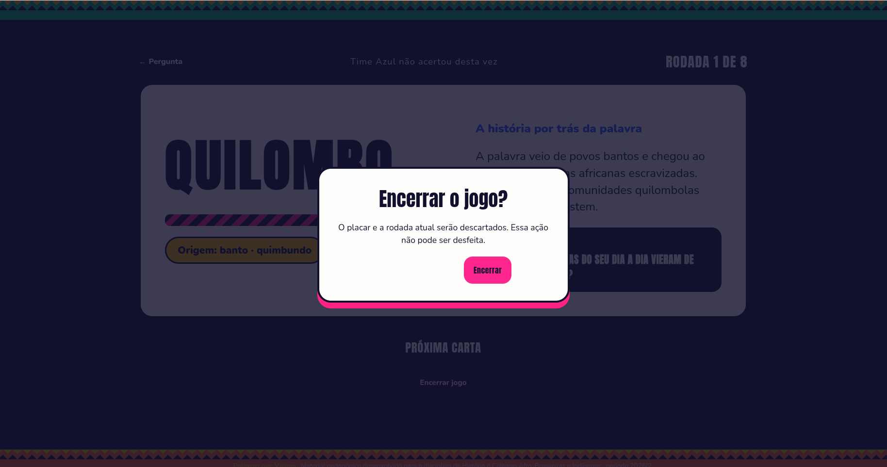

# Palavras que Viajam



**Palavras que Viajam** é um jogo educativo de navegador sobre palavras de origem africana e indígena presentes no vocabulário brasileiro. A turma joga em equipes, identifica a possível origem de cada palavra e conversa sobre os povos, línguas e histórias relacionadas a ela.

O projeto foi desenvolvido como material pedagógico para a disciplina **História e Culturas Afro-Brasileiras e Indígenas**, no período **2026/2**, na perspectiva da Educação para as Relações Étnico-Raciais (ERER).

## Público e proposta

- **Público-alvo:** estudantes do Ensino Fundamental II, especialmente 6º e 7º anos.
- **Formato:** jogo web em uma única página.
- **Uso em sala:** a professora pode projetar a tela e organizar a turma em equipes; não é necessário um dispositivo por estudante.
- **Objetivo:** reconhecer a presença de línguas e culturas africanas e indígenas no cotidiano, sem reduzir esses povos ao passado ou ao folclore.

## Como jogar

1. Leia as instruções na tela **Como jogar**.
2. Monte de 2 a 6 times e escolha um nome para cada um.
3. Defina a quantidade de rodadas.
4. Na vez do time, leia a palavra e a pista.
5. Escolha a língua de origem entre as opções africanas e indígenas.
6. Clique em **Virar a carta** para conferir a origem e ler a história da palavra.
7. O time ganha 1 ponto quando acerta.
8. Use a pergunta de **Roda de conversa** para dialogar com a turma antes da próxima carta.

Durante uma partida, é possível voltar à etapa anterior ou encerrar o jogo. O encerramento pede confirmação para evitar que o placar seja perdido por acidente.

## Telas do jogo

### Início


### Como jogar



### Montagem dos times



### Rodada



### Encerrar jogo



## Tecnologias

- HTML5
- CSS3
- JavaScript
- Google Fonts: Anton e Nunito

O projeto não utiliza framework nem banco de dados. As cartas e regras ficam no arquivo `app.js`, os estilos ficam em `styles.css` e a estrutura da página fica em `index.html`.

## Como executar localmente

Não é necessário instalar dependências. Basta abrir o arquivo `index.html` em um navegador.

Pelo terminal, no Linux:

```bash
xdg-open ./index.html
```

Também é possível abrir a pasta no VS Code e usar uma extensão como Live Server.

## Como adicionar novas palavras

As cartas ficam no array `cards`, no arquivo `app.js`. Para adicionar uma nova carta, inclua um objeto com:

```js
{
  word: "palavra",
  clue: "pista para a turma",
  origin: "origem · língua",
  answers: ["iorubá", "quimbundo", "quicongo", "fon · jeje"],
  indigenous: ["tupi", "guarani"],
  story: "Texto curto sobre a origem e a presença da palavra no Brasil.",
  question: "Pergunta para a roda de conversa?"
}
```

Antes de incluir o conteúdo, confira a origem linguística, a grafia e o contexto histórico em fontes de pesquisa confiáveis. A explicação deve valorizar os povos e evitar generalizações.

## Integrantes

- Petter Douglas Rodrigues Araújo
- Isabela Gomes Oliveira
- Vitoria Keda
- Marina Hermógenes Siqueira
- João Carlos
- Letícia Barros
- Mateus Milani Rodrigues
